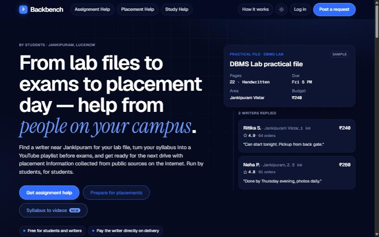
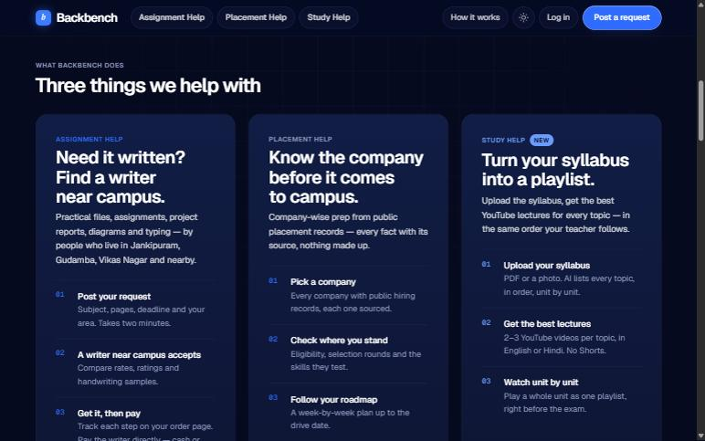
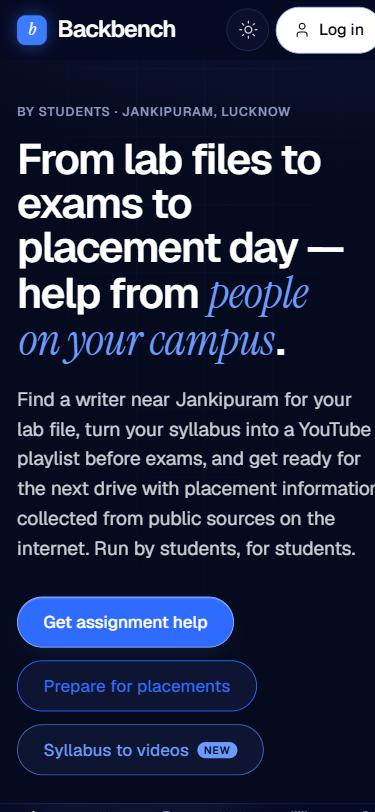
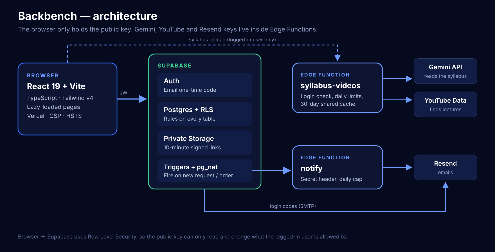
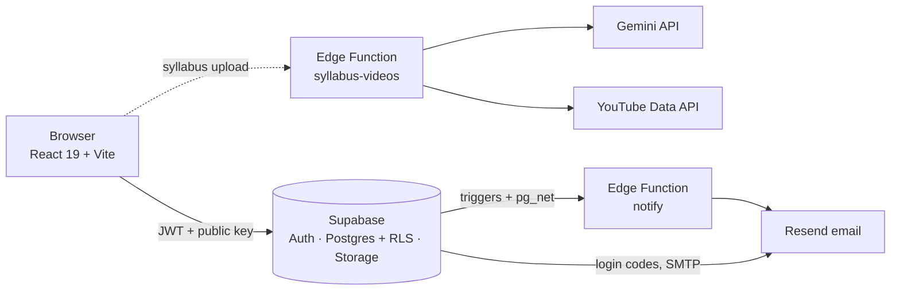

# Backbench

**A student-run help desk for the Faculty of Engineering & Technology (FoET), University of Lucknow.**
Lab files written by students who live near campus, placement prep built on sourced records, and a tool that turns a syllabus into an ordered YouTube playlist.

🔗 **Live:** [www.backbeench.in](https://www.backbeench.in)

> This repository is a **showcase**: the README, the architecture and a few selected source files.
> The full application source is private. Access can be shared for interviews on request.

---

## The problem

Every semester, B.Tech students run into the same three walls:

1. **Assignments and practical files** pile up right before submission, and there is no trusted way to find someone nearby who can help.
2. **Placements**: students don't know which companies visit, who is eligible, or what the rounds look like, and most information online is unverified.
3. **Exam prep**: the syllabus is a list of topic names, and finding the right lecture for each topic on YouTube takes hours.

## What Backbench does

| | Feature | How it works |
|---|---|---|
| ✍️ | **Assignment Help** | A student posts a request (pages, deadline, area, files or a Google Drive link). Verified writers within ~5 km send quotes. The student picks one, tracks the order stage by stage, and pays the writer **directly on delivery**, sharing a 4-digit handover code last. Backbench takes no commission. |
| 🎯 | **Placement Help** | Company-wise records collected from public sources, each fact linked to where it came from. Includes an eligibility check and a week-by-week roadmap. |
| ▶️ | **Study Help: Syllabus to videos** | Upload a syllabus PDF or photo. Gemini reads it into units and topics in the same order; the YouTube Data API finds 2–3 good lectures per topic (English or Hindi, no Shorts). Watch unit by unit as a playlist. |

Also: email one-time-code login (no passwords), writer applications with admin verification (college ID + handwriting sample), writer profiles with rates and locality, email notifications for new requests, quotes and orders, and an admin panel for moderation.

| Features | Mobile |
|---|---|
|  |  |

## Launch numbers

- **332** visitors on launch day
- **130+** students registered in the first days
- **0%** error rate at launch

## Architecture

- The **browser only ever holds the public (anon) key**. What it can read or change is decided by **Row Level Security** in Postgres.
- **API keys for Gemini, YouTube and Resend live only in Edge Functions**, never in the frontend bundle or the repository.
- Notifications are sent by **database triggers** that call the `notify` function in the background (`pg_net`), so an email problem never blocks a student's action.

## Tech stack

| Layer | Tools |
|---|---|
| Frontend | React 19, TypeScript, Vite 7, Tailwind CSS v4, custom router with lazy-loaded pages |
| Backend | Supabase: Postgres, Row Level Security, Auth (email OTP), private Storage, Edge Functions (Deno) |
| AI / APIs | Google Gemini (syllabus parsing), YouTube Data API v3 (lecture search) |
| Email | Resend (custom domain, SPF/DKIM/DMARC) |
| Hosting | Vercel (auto-deploy from `main`), custom domain on BigRock DNS |
| Ops | GitHub Actions: security audit on every push, scheduled keep-alive |

## Security summary

Backbench handles student contact details and real-money handovers, so security was designed in from the start:

- **Row Level Security on every table.** Students see only their own requests and orders; writers see open requests only after admin approval; nobody can change their own `status`, `verified` or `banned` flags (enforced by database triggers). Logged-out access to every private table returns `401`.
- **Passwordless login** with a 6-digit email code. Admin access is tied to a single verified address.
- **Private file storage.** Uploads go to `<user-id>/<uuid>.<ext>`. The file type is checked from the file's **real first bytes**, not its name, and files open only through 10-minute signed links for the people involved in that order.
- **Strict Content Security Policy** (only the project's own Supabase host is allowed), HSTS and `X-Frame-Options: DENY`.
- **Safe errors.** Only messages raised on purpose by the database are shown to users; anything else becomes a generic message, so table names and SQL never reach the screen.
- **Open-redirect protection** after login, **CSV formula-injection** protection in admin exports, and **rate limits / daily quotas** on the AI feature and on email.
- **Handover code** made with a secure random generator, with lockout after 5 wrong attempts.
- Google Drive links on requests are accepted only for `drive.google.com` / `docs.google.com`, checked in the browser and again in the database.

## Selected code

| File | What it shows |
|---|---|
| [`code/security.ts`](code/security.ts) | Small, dependency-free security helpers: open-redirect guard, real file-type sniffing, safe error messages, CSV injection guard |
| [`code/security.test.ts`](code/security.test.ts) | Unit tests for the helpers above, using Node's built-in test runner |
| [`code/RequestAttachments.tsx`](code/RequestAttachments.tsx) | React component that lists a request's private files and opens them through short-lived signed links |
| [`code/SyllabusFlow.tsx`](code/SyllabusFlow.tsx) | The animated four-step workflow diagram for "Syllabus to videos" |

These files are shared for reading. See [LICENSE](LICENSE).

## What I learned

- Designing **Row Level Security** policies and triggers so the database itself is the last line of defence, not the frontend.
- Keeping **third-party API keys server-side** and protecting free API quotas with per-user and site-wide limits plus caching.
- Running a real launch: custom domain and DNS, email deliverability (SPF/DKIM/DMARC), and fixing issues from real student feedback within hours.

## Author

**Kushagra Prajapati** — B.Tech CSE (AI), 2nd year, University of Lucknow
📧 kushagraprajapati2005@gmail.com · GitHub [@kushagracode18](https://github.com/kushagracode18)

---

*Backbench is an independent student project. It is not run by, endorsed by or affiliated with the University of Lucknow. Placement information is collected from public sources on the internet.*
